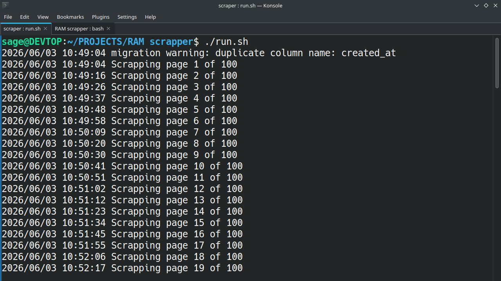
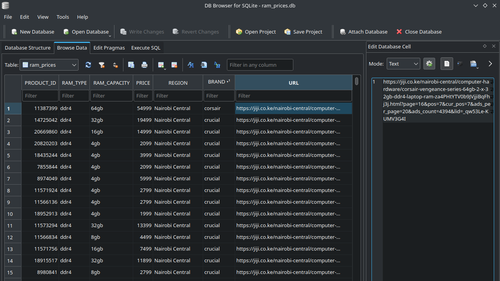
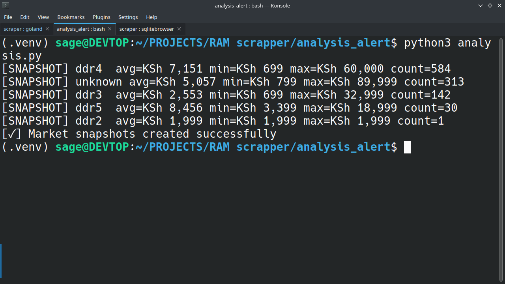
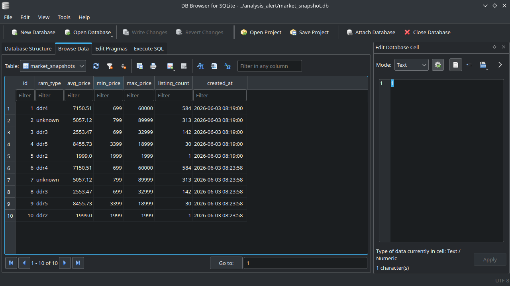
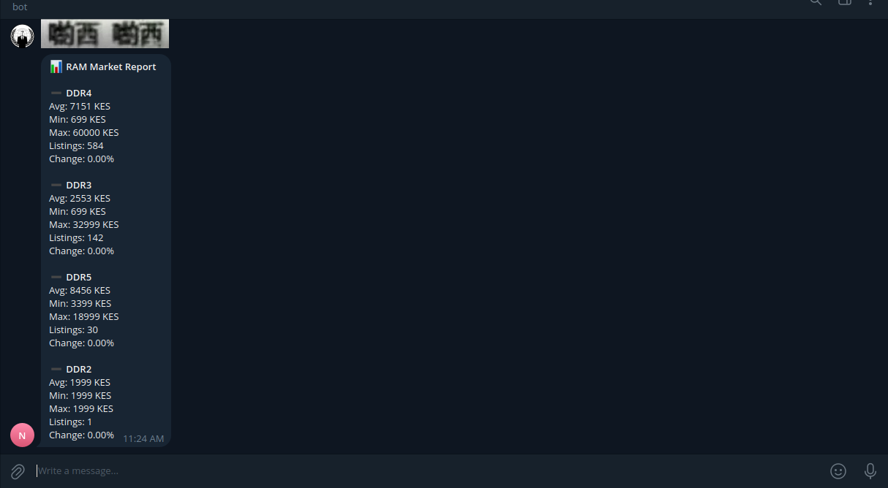

# RAM Market Monitor

A market monitoring and price comparison tool for tracking RAM prices across Kenyan online marketplaces.

The project collects RAM listings, stores them in a local database, analyzes market trends, and generates alerts based on price changes.

---

## Features

* Scrapes RAM listings from Kenyan online marketplaces
* Stores historical pricing data in SQLite
* Prevents duplicate entries
* Tracks DDR3, DDR4, and DDR5 listings
* Calculates average, minimum, and maximum prices
* Generates market snapshots over time
* Supports Telegram notifications
* Designed for scheduled execution using Cron or Task Scheduler

---

## Tech Stack

| Component     | Technology            |
| ------------- | --------------------- |
| Scraping      | Go                    |
| Storage       | SQLite                |
| Analysis      | Python + Pandas       |
| Notifications | Telegram Bot API      |
| Scheduling    | Cron / Task Scheduler |

---

## System Architecture

```text
             ┌─────────────┐
             │ Jiji API    │
             └──────┬──────┘
                    │
                    ▼
           ┌────────────────┐
           │ Go Scraper     │
           └──────┬─────────┘
                  │
                  ▼
           ┌────────────────┐
           │ SQLite DB      │
           └──────┬─────────┘
                  │
          ┌───────┴────────┐
          ▼                ▼
   Python Analysis   Telegram Alerts
```

---

# Project Walkthrough

## 1. Scraping Data

The scraper collects RAM listings from Kenyan online marketplaces and extracts relevant information such as:

* Product ID
* Product Title
* Price
* Region
* RAM Type
* Capacity
* Brand

### Screenshot


---

## 2. Storing Data

After collection, data is normalized and stored in SQLite.

Duplicate products are ignored using unique product identifiers.

### Screenshot



---

## 3. Market Analysis

Python scripts analyze stored market data and generate statistics including:

* Average price
* Minimum price
* Maximum price
* Listing count
* Historical snapshots

### Screenshot



---

## 4. Market Snapshots

The project stores periodic snapshots to track how RAM prices change over time.

This enables future trend analysis and price movement detection.

### Screenshot



---

## 5. Telegram Alerts

After analysis completes, alerts can be sent directly to Telegram.

Examples include:

* Cheapest RAM found
* Average DDR4 price
* Average DDR5 price
* Price change percentage since previous snapshot

### Screenshot



---

## Running

### Clone Repository

```bash
git clone https://As1agi/simple-scrapper ram-scrapper
cd ram-scrapper
```

### Run Pipeline

```bash
chmod +x run.sh
./run.sh
```

The script executes:

1. Go scraper
2. Python analysis
3. Telegram alert generation

set your Telegram bot token and chat ID in a .env file in the analysis_alert directory for telegram alerts

---

## Current Status

This project is currently stable but still under development.

### Implemented

* Jiji scraper
* SQLite storage
* Duplicate detection
* Data normalization
* Market snapshots
* Basic analytics
* Telegram alerts

### Planned
* More scrapers
* Docker deployment
* Dashboard visualizations
* Advanced trend analysis
* Proxy rotation

---

## Example Insights

The project can answer questions such as:

* What is the average DDR4 price today?
* What is the cheapest RAM currently listed?
* How many RAM listings exist in the market?
* Have prices increased or decreased since the previous snapshot?

---

## Use Cases

* Hardware market monitoring
* Price tracking
* Data engineering practice
* Web scraping practice
* Portfolio demonstration project

---

## Disclaimer

This project is intended for educational and research purposes.

Website structures and APIs may change over time, requiring scraper updates.
